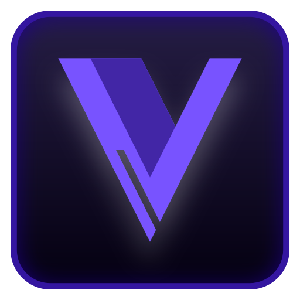
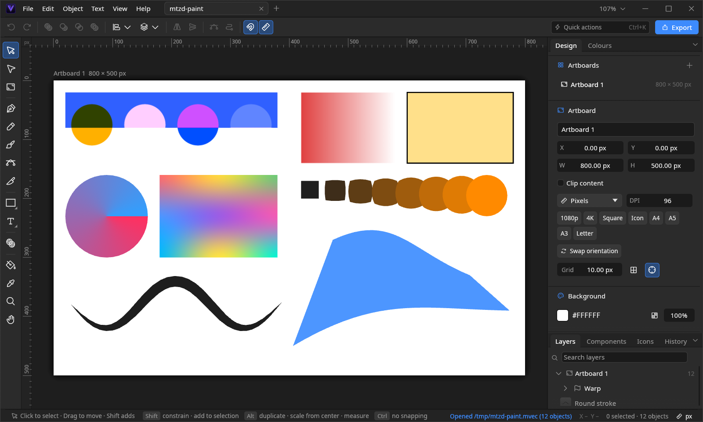

  

<h1 align="center">mtzdVector</h1>

  A fast, compact vector editor for Linux, written in Rust. 
  Illustration, UI design and print in one app, with documents saved as <code>.mvec</code>.

  <a href="#installation">Installation</a> ·
  <a href="#features">Features</a> ·
  <a href="#command-line">Command line</a> ·
  <a href="#development">Development</a> ·
  <a href="#license">License</a>

> [!NOTE]
> **This project is vibe coded.** It is written almost entirely with an AI
> coding assistant, and I steer it rather than write the code by hand.
> It only exists because, in my opinion, Linux has no good vector design
> tools, so I made the one I wanted to use.
> I'm not looking for outside contributions, so please don't open pull
> requests. **Bug reports are welcome**: open an issue with steps to
> reproduce and, if you can, the file that shows the problem.

## Highlights

- **Draw anything:** pen, pencil, 29 vector brushes, live booleans, a shape builder and 16 parametric primitives.
- **Stay editable:** warps, blends, booleans, outlines and auto layout remain live until you expand them.
- **Design systems:** components with variants, overrides and shared libraries, plus auto layout and constraints.
- **Print-ready output:** CMYK PDF through ICC profiles, spot colours, bleed, crop marks and PDF/X-4.
- **Open almost anything:** SVG, PDF, Illustrator, EPS and images in; PNG, JPG, WebP, AVIF, SVG, PDF, EPS and DXF out.
- **Feels native on Linux:** Wayland pen pressure, file manager thumbnails, a Flatpak and a headless batch exporter.

## Installation

### Flatpak (recommended)

All you need is `flatpak`. The build script does the rest: it adds the
Flathub remote for your user, gets `flatpak-builder` (or the
`org.flatpak.Builder` Flatpak), vendors the Rust crates, then builds and
installs the app.

    packaging/flatpak/build.sh           # build and install, or update the installed version
    packaging/flatpak/build.sh --run     # … and start it
    packaging/flatpak/build.sh --clean   # rebuild from scratch
    packaging/flatpak/build.sh --bundle  # also write mtzd-vector.flatpak to share

Run it again after pulling changes to update. The first build downloads the
Freedesktop SDK and the Rust toolchain extension.

Start it from your app launcher, or:

    flatpak run pro.mtzd.MtzdVector [FILE.mvec …]

The launcher, icon and `.mvec` file type come with it, so double-clicking a
`.mvec` file opens it. To remove it:
`flatpak uninstall --user pro.mtzd.MtzdVector`.

### From source

You need Rust 1.85 or newer (edition 2024), a C toolchain, the Wayland and
X11 development headers your distro uses for winit, and a GPU driver with
Vulkan or OpenGL.

    cargo build --release
    ./target/release/mtzd-vector

On first start the binary registers itself for your user, and refreshes
that registration when something changes. It writes these files to
`~/.local/share`:

| File | Purpose |
|---|---|
| `applications/pro.mtzd.MtzdVector.desktop` | launcher and `.mvec` handler |
| `icons/hicolor/*/apps/pro.mtzd.MtzdVector.png` | app icon |
| `mime/packages/pro.mtzd.MtzdVector.xml` | the file type (`update-mime-database` runs automatically) |
| `thumbnailers/mtzdVector.thumbnailer` | file manager thumbnails |

To register without opening a window, for example after moving the binary,
run `mtzd-vector --install-desktop`. To uninstall, delete the binary and
those files, then run `update-mime-database ~/.local/share/mime`.

### Thumbnails

File managers show `.mvec` previews through a standard `.thumbnailer` entry
(the same mechanism FreeCAD uses), read by Dolphin, GNOME Files, Nemo,
Thunar and Caja. The app writes it on start, pointing at the native binary
or at `flatpak run`, so there's nothing extra to install.

Dolphin only previews the file types ticked in its settings. If you saved
those settings before, tick **mtzdVector** under
*Settings › Interface › Previews*, then restart Dolphin.

## Features

### Drawing

- Rectangles, ellipses, stars, polygons and 16 parametric primitives (arrow, cog, spiral, callouts, QR code…).
- Pen, pencil, node editor, corner tool, knife and shape builder.
- Shear by dragging just beside a middle handle of the selection; the selection box follows the slant.
- **Brushes:** 29 vector brushes in seven categories (basic, inks, pencils, dry media, paint, watercolour, texture), each previewed in the brush menu. Simple brushes are one stroke with a width profile. Media brushes such as bristle, chalk, wash, spray and hatching build a group of editable strands, dots or ticks. Strokes draw live as you paint.
- **Pen pressure** on Wayland through the tablet protocol (Preferences › Tablet, applies after a restart); without a tablet the width follows drawing speed.
- **Stabilizer** for pencil, brush and knife, in rope or window mode.

### Paths and live effects

- Live booleans (union, subtract, intersect, exclude), offset, simplify, expand stroke and convert to curves.
- **Envelope warp** (10 styles plus perspective-like distortion) and **blends** between two shapes stay editable in the Design panel. A blend follows when you edit either end. *Expand* turns the result into plain shapes; *Release* gives the originals back.
- **Image trace** with spline fitting and sharp corners, one stacked layer per colour; it's in the right-click menu of images.

### Paint and effects

- Stacked fills and strokes; solid, linear, radial, conic and mesh gradients edited on the canvas (double-click inside a mesh to slice it); image fills.
- Blend modes, luminance and opacity masks, and named colour keys that keep linked fills and strokes in sync.
- Strokes with inside, centre or outside alignment, width profiles, dashes, arrowheads, joins and caps.
- Drop and inner shadows, layer blur, noise and stacked outlines, on shapes and groups.

### Text

- Artistic, frame and on-path text, threaded frames and text wrap.
- Paragraph and character styles, hyphenation, spell check, letter case and small caps.
- Google Fonts. PDF and SVG keep text as real, selectable text, or outline it.

### Layout and components

- **Auto layout:** rows or columns with gap, per-side padding and alignment, reordered by dragging. The group's own fill and stroke paint its background.
- **Constraints** set how members follow when their group is resized.
- **Components:** instances with per-layer overrides; variants (property sets such as State = Hover) that instances switch between while keeping their overrides; text and visibility properties.
- **Shared libraries:** other `.mvec` documents provide components and colour keys, and an Update button pulls in their changes.
- **Layers panel:** drag one or many layers into groups, compounds and auto layouts. Shapes, components and icons dropped onto an auto layout on the canvas join it.

### Documents, print and formats

- Multiple artboards, clip masks, tabs, autosave, crash recovery and atomic saves with an optional backup.
- **Print:** CMYK PDF through an ICC profile (installed profiles are found automatically), spot colours as separations, exact CMYK values per colour key, bleed, crop marks, PDF/X-4, and File › Print through the desktop print dialog.
- **Import:** SVG, PDF (at true size), Illustrator (`.ai`, PDF-based or PostScript via Ghostscript), EPS and images.
- **Export:** PNG, JPG, WebP (lossless), AVIF, SVG (precision, ids, minify, responsive), PDF (one page per artboard), EPS and DXF (R12 polylines in mm, for cutters and CAD).
- **Export slices:** give any layer or artboard export settings (for example @1x, @2x and @3x PNG plus an SVG) in the Design panel, then write them all with File › Export Slices or `--export --slices`.

### Finding things

Press **Ctrl+K** for quick actions: every command and tool, found by name or
by the names other apps use. Typing "distort" finds Envelope Warp,
"pathfinder" the booleans, and "vectorize" Image Trace.

## Command line

    mtzd-vector [FILE …]                         open files (each in a tab)
    mtzd-vector --export [OPTIONS] INPUT…        convert / export without a window
    mtzd-vector --thumbnail IN|- OUT|- [SIZE]    PNG preview of the first artboard (CPU only)
    mtzd-vector --install-desktop                register launcher, icons, MIME type, thumbnailer
    mtzd-vector --write-icons DIR                write the hicolor icon set (packaging)
    mtzd-vector --screenshot OUT.png [FILE] [--size WxH] [--scale S] [--frames N]
    mtzd-vector --script SCRIPT [FILE] [--size WxH] [--scale S]

`--screenshot` and `--script` render the UI offscreen without opening a
window, which is handy for tests and documentation.

### Batch export

`--export` opens each input (`.mvec`, SVG, PDF, AI, EPS) and writes it in the
format given by `-f` or the output's extension. Run
`mtzd-vector --export --help` for every option.

    mtzd-vector --export logo.mvec -o logo.png -s 2              # 2× PNG of the first artboard
    mtzd-vector --export logo.mvec -o logo.svg --minify --precision 2
    mtzd-vector --export *.ai -o converted/ -f svg               # batch: one SVG per file
    mtzd-vector --export book.mvec --all-artboards -o book.pdf --cmyk --pdfx --bleed 3 --crop-marks
    mtzd-vector --export ui.mvec --artboard "Sign in" -o signin.webp --transparent
    mtzd-vector --export icons.mvec --slices -o assets/          # every layer's export settings

It exits with 0 on success, 1 if any input failed, and 2 on a usage error.
From the Flatpak, use `flatpak run pro.mtzd.MtzdVector --export …`.

None of the headless modes (`--export`, `--screenshot`, `--script`) write
settings, recent files or autosaves.

## Data locations

| What | Native | Flatpak |
|---|---|---|
| Settings, recent files, autosaves, downloaded fonts | `~/.local/share/mtzd-vector/` | `~/.var/app/pro.mtzd.MtzdVector/data/mtzd-vector/` |
| Caches (Google Fonts list and previews, icon search) | `~/.cache/mtzd-vector/` | `~/.var/app/pro.mtzd.MtzdVector/cache/mtzd-vector/` |

## Development

    cargo test                                                            # unit and UI-driver tests
    cargo test write_demo -- --ignored                                    # writes demo documents to /tmp
    cargo test --release bench_large_documents -- --ignored --nocapture   # benchmarks, see docs/PERFORMANCE.md

Packaging files and notes live in [`packaging/`](packaging/README.md).

App id `pro.mtzd.MtzdVector` · MIME type `application/x-mtzdvector`

## License

mtzdVector is released under the [MIT License](LICENSE).

It's built on many open-source crates, all under MIT-compatible licences
(MIT, Apache-2.0, BSD, ISC, Zlib and similar, plus file-level MPL-2.0 for
the Hunspell engine). The binary also embeds egui's default fonts (SIL Open
Font License and Ubuntu Font Licence) and TeX hyphenation patterns, which
keep their own authors' licences. Icons, dictionaries and Google Fonts are
downloaded on demand and come under their providers' licences.
